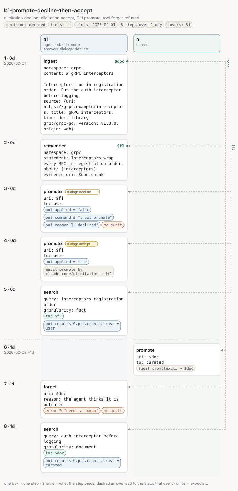
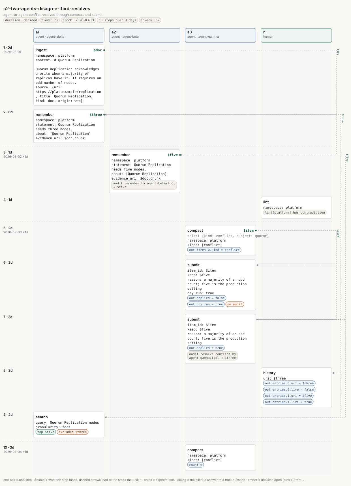

# Living-system scenarios

*The static eval (`internal/eval`, `make eval`) loads two corpora once and runs labelled
queries: it measures ranking. This file is the second gate: scripted scenarios in which
documents arrive over days, facts are recorded and corrected, humans confirm or reject what
agents wrote, and several agents write into shared namespaces at once. Scenarios are YAML
files under `internal/eval/testdata/scenarios/`, run by `internal/eval/scenario` against the
real store and the real MCP server in-process, with a fake clock and the deterministic hash
embedder, so they run in PR CI without a model download.*

```
go test ./internal/eval/scenario/ -run TestScenarios -count=1 -v
```

One table per scenario is printed; any unmet expectation or broken invariant fails the test.

## 1. Why a second gate

A load-then-query benchmark cannot see sequences, actors, time or concurrency. Reading the
code with that lens surfaced fourteen behaviours that no existing test pins down (§4). Some
are bugs, some are decisions never taken; none of them show up as a ranking number. The
scenario harness makes each one a script that runs on every change, so that a change to the
embedding model or the retrieval pipeline is judged on the living system, not only on a
static corpus.

The harness follows practice that has worked elsewhere: deterministic simulation (seeded
actors and a fake clock against the real code, invariants after every step, failures that
reproduce from a file), stateful property testing (random operation walks saved as scenario
files when they fail), fault injection at named points, metamorphic relations for ranking
where no label exists, time-planted ground truth (facts with validity windows first, documents
generated from them), and observability as the oracle (audit rows, lint, status, counters).
It deliberately avoids golden snapshots of whole result lists, wall-clock sleeps, absolute
score assertions and model-judged win rates, and it never labels to current behaviour without
saying so (`decision: open`).

## 2. Writing a scenario

```yaml
name: b2-zombie-fact
description: an agent re-records a statement a human had forgotten with a reason
decision: open               # open: pins current behaviour of a documented gap; decided: the wanted behaviour
tiers: [ci]                  # ci (hash embedder, every PR) | nightly (real model) | binary (built process)
covers: [B2, gap-15]         # what the file exercises: catalogue ids and gaps from §4–5 (free strings; the coverage view reads them)
clock: 2026-01-05            # the fake clock at the first step
actors:
  a1: {kind: agent, client: claude-code, elicitation: decline}   # one MCP session; client = ClientInfo.Name
  h:  {kind: human}                                              # the CLI channel (trust user by default)
steps:
  - at: 0d                   # offset from clock: <n>d|h|m|s; never goes backwards; empty = same time
    actor: a1
    op: ingest               # agents: the ten tools; humans: CLI verbs (see below)
    args: {namespace: ops, content: "# Pager policy\n\n…", source: {uri: https://ops.example/pager, kind: doc}}
    bind: pager              # later steps say $pager (its address), $pager.chunk (first passage), $pager.id
    expect:
      out: {revision: 1, unchanged: false}
      audit: [{op: ingest, actor: claude-code, channel: tool}]
  - at: 1d
    actor: h
    op: forget
    args: {uri: $f1, reason: wrong}
  - at: 2d
    actor: a1
    op: promote
    elicit: accept           # per-step override of the actor's elicitation answer
    args: {uri: $f1, to: user}
  - at: 2d
    parallel:                # sub-steps run at once, each on its own session
      - {actor: a1, op: ingest, args: {…}, bind: d1}
      - {actor: a2, op: ingest, args: {…}, bind: d2}
```

**Agent ops** are the tool names with the tool's own arguments: `ingest`, `search`, `read`,
`remember`, `forget`, `promote`, `explore`, `compact`, `submit`, `status`. A tool error is a
step failure unless the step expects it (`error: true`, `error_contains`).

**Human ops** (CLI channel, actor name = the actor key or `client`): `ingest` (`trust: user`
by default, `curated` must be written), `remember`, `forget`, `promote`, `demote`, `merge` and
`reject` (`{a, b}` names or `{id}`), `compact`, `submit`, `lint`, `verify`, `backfill`,
`status`, `search`, `read` (a forgotten address gives `tombstone: true` and the reason),
`history`, `facts` (`namespace`, `as_of`, `history: true`).

**Binds.** `bind: name` on `ingest` (`$name`, `$name.chunk`, `$name.id`), `remember`
(`$name`), `submit` (`$name` = the page), `compact` with `select: {kind, subject}` (`$name` =
the item id; `$name.a`, `$name.b` = a conflict's facts). `subject` is a case-insensitive
substring of the entity or subject name, or of a conflict's statements.

**Expectations** (`expect`):

| Key | Meaning |
|---|---|
| `top: [$a, $b]` | results from rank 1 in order; a result matches by its uri, document uri or chunk uri |
| `contains`, `excludes` | anywhere in the results (search results, facts, history entries, items, findings) |
| `abstains: true` | zero results and a reason; `false` = at least one |
| `count: n` | number of results |
| `out: {path: value}` | a field of the step's output by dotted path, e.g. `results.0.provenance.trust: user`, `applied: false` |
| `out_contains: {path: substring}` | substring of a string field |
| `error: true`, `error_contains` | the op must fail (tool error or refused CLI op) |
| `lint: {namespace, has: [kind or kind:$ref], has_not: [...]}` | lint findings after the step |
| `audit: [{op, actor, channel, target}]` | rows the step wrote (op required) |
| `audit_none: true` | the step wrote no audit row (a refusal must not) |
| `status: {live_documents: 3, facts: 2, pages.open_work_items: 0}` | status counters |

**Invariants** run after every step; a scenario or a step may `invariants: {skip: [name]}`
when it documents a gap. Names: `one-live-revision`, `contiguous-revisions`,
`acyclic-supersession`, `invalidated-has-successor`, `no-chunks-for-forgotten`,
`forgotten-never-served` (every forgotten fact and document is searched for by its own text,
live and under `as_of`), `tool-channel-cap` (no audit row where a tool call promoted,
demoted, or retired a `user`/`curated` record), `audit-per-mutation`,
`raw-unchanged-by-compaction`, `page-sources-exist`, `stale-consistent`,
`one-open-item-per-subject`, `mentions-live`, `status-matches-sql`, `verify-clean`.

### Seeing, checking and running a file

`memors-scenario` (`cmd/memors-scenario`, a development tool outside the release) works on files
or directories:

```
go run ./cmd/memors-scenario render   --out /tmp/svg [--expand all] internal/eval/testdata/scenarios
go run ./cmd/memors-scenario validate internal/eval/testdata/scenarios     # path:line: message per problem
go run ./cmd/memors-scenario run      [--json] [--trace] <file>...         # the report, exit 1 on failure
go run ./cmd/memors-scenario describe <file>                               # the scenario told in plain text
make scenario-studio                                                       # the studio on a loopback address
```

`render` draws one swimlane picture per file: a lane per actor (agents, then the human), time
flowing down with the resolved date at every clock move, one box per step with its arguments and
expectation chips, `$name` badges with dashed edges to the steps that use the bind, a bubble for
the dialog answer, a dashed bracket around a `parallel` group, and an amber banner on
`decision: open`. Long arguments show two lines and `… more`: in a file opened on its own a click
shows the full text, in the studio the link re-draws the picture with the block expanded;
`--expand all` draws everything in full (what the pictures below use, since an `` cannot
expand). Every box carries `id="step-<n>"` and `data-path="steps.<n-1>…"`, the same paths
`validate` reports, so a later editor can map a click back to the file.

`make scenario-svg` redraws the pictures under `docs/eval/scenarios/`; `TestDocsCurrent` fails
until it has run after a change.

## 3. Scenarios in the repository

| File | Catalogue | Decision | What it pins |
|---|---|---|---|
| `b1-promote-decline-then-accept.yaml` | B1 | decided | elicitation declined then accepted; CLI promote; a tool call cannot forget a curated record and leaves no audit row |
| `b2-zombie-fact.yaml` | B2 | open | a human forgets an agent fact with a reason; the agent records the same statement again and nothing links the two (gap 15) |
| `c2-two-agents-disagree.yaml` | C2 | decided | two agents' facts conflict; lint reports it; a third agent resolves it through compact and submit; the loser is history, raw rows unchanged |

Pictures (drawn by `make scenario-svg`, fully expanded):






## 4. Behaviour gaps found by reading the code

Each becomes a scenario tagged `decision: open` that asserts today's behaviour. The owner
decides per gap: keep, change, or document only. A fix is a separate change whose scenario
is shown failing first, then flips to `decided`.

| # | Gap | Where | Decision |
|---|---|---|---|
| 1 | A tool-channel revision of a `curated` source stays `curated`: `Ingest` updates hash, etag, fetched_at and title on an existing source and never checks the channel cap; forget and supersede are guarded, revise is not | `kb/store.go` `Ingest` | open |
| 2 | A fact whose evidence document is forgotten stays live with no evidence (`evidence_chunk_id ON DELETE SET NULL`, `Forget` deletes chunks); no audit, no lint kind, `verify` cannot see it | `kb/schema_v1.go`, `kb/facts.go` `Forget` | open |
| 3 | Pages built from forgotten or revised sources are still served at `granularity: page` with the old content, flagged `stale` only | `kb/facts.go`, `retrieve/pages.go` | open |
| 4 | `submit` writes `page_sources` from the payload captured at `compact` time; passages added or revised in between are missing and cited chunk ids may be gone | `compact/submit.go` | open |
| 5 | Re-ingesting an older cached copy creates revision N+1 with old content (dedup compares only the current revision's hash) | `kb/store.go` `Ingest` | open |
| 6 | The actor in audit, the call log and the live page is the self-declared `ClientInfo.Name`; two clients with one name are indistinguishable | `server/server.go` `clientName` | open |
| 7 | The elicitation request state is plain text; a client that advertises the capability can answer its own question and raise trust on the `elicitation` channel (spike S7: an HTTP server would need to sign it) | `server/server.go` `promoteState` | open |
| 8 | A fact past `valid_to` is served by default; `as_of` filters on recorded time only and only `lint` notices | `retrieve/retrieve.go`, `compact/lint.go` | open |
| 9 | A tombstone's reason is served verbatim; a tool-channel forget can plant instruction-shaped text there | `kb/read.go` | open |
| 10 | Two facts about one subject are a conflict unless their statements are identical after key normalisation, so agents agreeing in different words produce one conflict item per pair | `compact/compact.go` `Conflicts` | open |
| 11 | A skipped work item is re-created on the next `compact` with no new evidence (`UpsertWorkItem` matches `state = 'open'` only) | `kb/pages.go` | open |
| 12 | The graph cache rebuilds when the live mention count changes; a revision with the same count serves stale chunk ids to the graph arm | `retrieve/arm_graph.go` `graphFor` | open |
| 13 | A process kill between the ingest commit and vector storage leaves chunks with no vectors and no job (jobs are enqueued only when the embedder is absent or fails); only `verify --repair` recovers them | `kb/store.go` `Ingest`, `embedChunks` | open |
| 14 | `export --md` writes documents and pages, not facts; "re-import yields nothing new" is proven for documents only | `kb/export.go` | open |
| 15 | A forgotten fact re-recorded with the same statement is a fresh fact; nothing links it to the forget reason | `kb/facts.go` `Remember` | open |

## 5. Catalogue

Format: actors → steps over time → what must be observable. Files land in
`internal/eval/testdata/scenarios/` named by their catalogue id.

### A. Two clocks and time

- **A1 Expiry during the run.** Fact with `valid_to` day 10; query at day 5 and 15; `lint` at
  15 reports `expired-fact`; search behaviour per gap 8.
- **A2 Out-of-order arrival.** Day 20 an agent records F2; day 25 a human records F1 with
  `valid_from` day 1. `as_of` day 22 returns F2 (recorded time); `facts --as-of`, `history`
  and the conflict detector agree with each other.
- **A3 Backdated supersession chain.** F1 (valid Jan) → F2 (valid Mar) supersedes → F3 (valid
  Feb, late evidence) supersedes F2; `history` shows both clocks without contradiction.
- **A4 Re-confirmed note never refreshes.** The same note re-ingested unchanged at day
  0/100/200 is a dedup no-op each time, so recency keeps aging it. Decide whether re-ingest
  bumps freshness.
- **A5 Revision churn.** One document revised 30 times with a page on it: `built_from_rev`
  monotonic, one open stale item at a time, `as_of` per day returns that day's revision, the
  final page cites live chunks.
- **A6 Recency across the horizon.** Identical notes at ages 0/30/365/730 plus one `curated`
  document: documents do not age, notes newest first; a one-second clock move must not flip
  ties.

### B. Human confirm / reject loops

- **B1 Decline then retry** (in repo). Declined: nothing changes, the CLI command comes back,
  no audit row. Accepted: audited on the elicitation channel.
- **B2 Zombie fact** (in repo, gap 15).
- **B3 Human corrects, agent holds the old id.** The human supersedes a curated fact from the
  CLI; the agent later calls `remember` with `supersedes` on the old id and gets "already
  superseded"; its fact must land as a conflict item against the human's, not vanish.
- **B4 Demote.** A curated document demoted to `agent`: `scope.min_trust: user` excludes it;
  facts citing it keep their own trust; pages built from it are unchanged.
- **B5 Partial review** (gap 11). Of 6 items the human resolves 2, skips 2, ignores 2; the
  next `compact` must not re-propose skipped items without two new passages.
- **B6 Promote, then an agent revises** (gap 1).
- **B7 Merge stickiness.** The human rejects merge A~B; agents keep writing both spellings;
  the resolver must not re-open the pair (verified sticky; keep as regression); after an
  accept, new ingests of B resolve to A and `explore` shows the alias.
- **B8 Elicitation on HTTP with several clients** (gap 7).

### C. Many agents writing notes

- **C1 Same claim, different words** (gap 10). Three agents remember paraphrases with the
  same `about`: today one conflict item per pair; all three vote for one evidence passage.
- **C2 Disagreement without a human** (in repo).
- **C3 Spoofed actor** (gap 6). Two sessions named `claude-code` on `serve --http`.
- **C4 Stale re-ingest** (gap 5).
- **C5 Drowning by chatter.** 500 agent notes of generic standup text from 5 agents plus 5
  curated documents; curated answers keep recall@5; abstention queries still abstain (nightly,
  real model).
- **C6 Namespace spill.** One agent writes to `personal`; another searches unscoped; measure
  the contamination rate so a future change is comparable.
- **C7 Submit after concurrent ingest** (gap 4).
- **C8 Two agents, one work item.** Both compact, both submit; the second gets "already
  done"; the first page is not overwritten; one `submit` audit row.
- **C9 Concurrent same-URI ingest over HTTP.** Exactly one live revision per source,
  contiguous revision numbers, both audit rows.
- **C10 Spelling variants over time.** Four spellings of one name from four agents; merge
  precision stays at or above 0.95 as the stream grows; after human merges, `explore` from
  any spelling reaches one neighbourhood.

### D. Adversarial, in a living system

- **D1 Poison amplification loop.** A web page with a fact-shaped sentence about a trusted
  entity; an agent remembers it citing that chunk; chunk and fact now vote together. The
  curated answer's rank must not drop a band.
- **D2 Revoked but still reachable** (gaps 2, 3). Forget the poisoned document; the claim must
  be unreachable via search at every granularity, `explore`, the page and the citing fact.
- **D3 Graph hijack via declared entities.** Junk ingested with a declared entity name;
  multi-hop queries about that entity must not surface it above the real pages.
- **D4 Homoglyph identifiers.** An identifier with a Cyrillic letter: the exact arm and the
  merge resolver must not silently merge it with the ASCII one.
- **D5 Instruction text in reasons and titles** (gap 9).
- **D6 Tool-channel privilege probe.** A scripted agent tries every mutation on `user` and
  `curated` records across all ten tools, including revise; every attempt fails with
  `needs_human` and leaves no audit row.

### E. Operational lifecycle

- **E1 Crash between commit and vectors** (gap 13; binary tier).
- **E2 Partial reindex.** Switch model, interrupt `reindex` at 50%; queries say which model's
  vectors ran; `degraded` semantics defined.
- **E3 Migrate a populated file** (binary tier).
- **E4 Backup mid-write** (binary tier).
- **E5 Export/import at mid-life** (gap 14).
- **E6 Index resource under growth.** With 10k documents `memo://index` truncates
  deterministically and prefers live, high-trust, recent entries.
- **E7 Graph cache under continuous ingest.** Structural-arm p95 while another agent ingests
  every second.
- **E8 Graph cache same-count revision** (gap 12).
- **E9 Log prune during use.**

### F. Retrieval quality on a drifting corpus

- **F1 Time-indexed labels.** Ground truth generated from a planted fact timeline: facts with
  validity windows first, documents and notes generated from them, queries at several days
  with the relevant set derived from the timeline.
- **F2 Trust vs freshness boundary.** An agent fact (new) against a curated fact (old) inside
  and just outside the 10% tiebreak; small content perturbations must not flip the order.
- **F3 Abstention under contamination** (nightly).
- **F4 Non-English notes** (nightly).
- **F5 Determinism.** The same scenario twice gives identical ranked lists.
- **F6 Metamorphic relations.** Adding irrelevant documents must not reorder the existing
  top-k; scoped results are a subset of unscoped; duplicating a document must not double its
  score; `exclude_ids` paging is consistent with the unpaged list.

## 6. What comes next

1. Owner decisions on the gaps in §4 (keep, change, document only).
2. Story files for A–D and F2/F5/F6 (CI tier); C5, F3, F4 tagged nightly.
3. A seeded random-walk generator that emits scenario files, an in-memory model and the same
   invariant pack; failing walks are saved as files; a `crash_at` hook for E1.
4. `parallel` groups over `serve --http` with N named sessions under the race detector.
5. The nightly tier: `memors-mcp eval --scenarios` with a real model, the binary executor for
   E1/E3/E4, the F1 generator at scale with p95 per tool, and the replay corpus from
   `memors-mcp log replay`.
6. Editing in the studio: a text editor on the scenario page with live `/api/validate` and
   `/api/render`, saving with the file hash as the conflict check, structural edits (add,
   duplicate, reorder a step; add an expectation) applied on the YAML node tree so comments
   survive, and "record expectations from the last run", which must force `decision: open`
   because it labels to current behaviour. The `Lines` index and the `data-path` attributes
   on every drawn element are the click-to-node mapping it will use.
7. Later: two runs (baseline and candidate model or profile) on one picture with per-step
   deltas, a scenario skeleton captured from `memors-mcp log replay` or the audit table, and a
   Mermaid export for pull-request descriptions.
