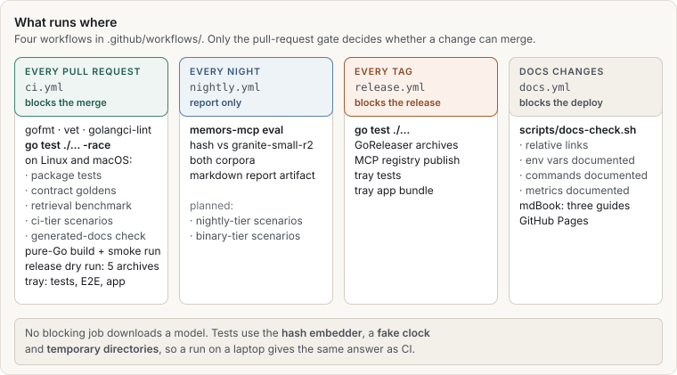

# For testers

This guide is for anyone who checks that memors-mcp does what it says: people who run the test
suite before a release, write new tests, review a pull request's test changes, or explore the
system by hand to find what the tests miss. It assumes you can use a terminal and read Go test
output. You do not need to know the code base. Each page names the files it talks about.

> **New to memors-mcp itself?** The [user guide](../user/) explains what it does, and the
> [operator guide](../operator/) explains how it works inside. This guide covers how it is
> **tested**.

## The gates at a glance

Every change to `master` passes one gate: `go test ./... -race -count=1` on Linux and macOS,
plus gofmt, vet, golangci-lint, a pure-Go build and a release dry run. That one command
includes far more than unit tests:

| Inside `go test ./...` | What it protects | Page |
|---|---|---|
| Package tests | Each package's behaviour, with real SQLite files in temporary directories | [What is tested where](start/map.md) |
| Contract goldens | The ten-tool MCP surface, `/live.json`, the metric text, the scenario pictures | [Contract and golden tests](gates/goldens.md) |
| The retrieval benchmark | Ranking quality against a recorded baseline, query by query | [The retrieval benchmark](gates/retrieval-eval.md) |
| Living-system scenarios | Sequences over time: agents, a human, a fake clock, and invariants after every step | [Scenario tests](scenarios/README.md) |
| Generated-docs freshness | The scenario pages of this guide match the scenario files | [Documentation checks](gates/docs.md) |

No test in the gate downloads a model. Everything uses a deterministic **hash embedder**, so a
run on a laptop gives the same answer as CI. Real models only run in the nightly job, which
reports results but blocks nothing.

## Where to start

- **Run everything once:** [Running the tests](start/running.md).
- **Find the tests for an area:** [What is tested where](start/map.md).
- **Write or read a scenario:** [Your first scenario](scenarios/first.md), then
  [Writing scenarios](scenarios/dsl.md).
- **See which scenarios exist today:** the [implemented scenarios](scenarios/log/README.md)
  log. It is generated from the files, so it is always what CI runs.
- **Look for bugs by hand:** [Exploratory testing](explore/README.md).
- **Add a test to a pull request:** [Adding tests](contributing/README.md).

## Conventions in this guide

- Commands run from the repository root unless a page says otherwise.
- `memors-mcp` is the product binary. `memors-scenario` (`go run ./cmd/memors-scenario`) is
  a development tool for scenario files and is not part of a release.
- "Scenario" always means a living-system scenario file under
  `internal/eval/testdata/scenarios/`. "Eval" or "benchmark" means the static retrieval
  benchmark in `internal/eval`.
