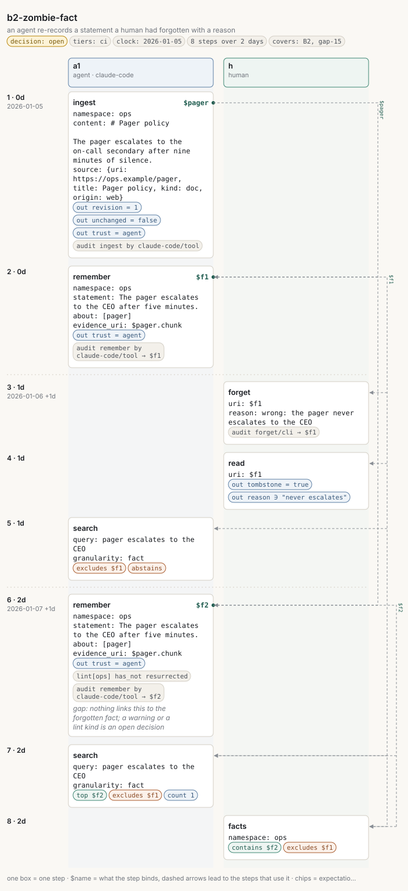

# b2-zombie-fact

<!-- Generated by `memors-scenario book` from `internal/eval/testdata/scenarios/b2-zombie-fact.yaml`. Do not edit: change the source and run `make scenario-docs`. -->

*an agent re-records a statement a human had forgotten with a reason*

- **Decision:** open: the expectations pin today's behaviour of a documented gap, not the behaviour anyone has chosen ([Open and decided](../decisions.md))
- **Tiers:** ci
- **Covers:** [B2 Zombie fact](../catalogue.md#b2) · [gap 15](../gaps.md#gap-15)
- **Actors:** `a1` agent, client `claude-code` · `h` human
- **Length:** 8 steps over 2 days from 2026-01-05
- **Source:** [`internal/eval/testdata/scenarios/b2-zombie-fact.yaml`](https://github.com/kKEo/memors/blob/master/internal/eval/testdata/scenarios/b2-zombie-fact.yaml)

## Why it exists

B2 — Zombie fact. A human forgets an agent fact with a reason; next session the same agent records the same statement again. Today nothing links the new fact to the forgotten one (gap: zombie facts). This scenario pins current behaviour until the owner decides on a warning at remember time or a `resurrected` lint kind; the last expectation is the one that will flip.

## Picture



[Open the picture on its own](b2-zombie-fact.svg) to zoom. [Reading the picture](../pictures.md) explains lanes, chips and edges.

## Steps

| # | When | Actor | Op | What | Bind | Expects |
|---|---|---|---|---|---|---|
| 1 | Jan 5 (0d) | `a1` | `ingest` | \# Pager policy | `$pager` | out, audit |
| 2 | Jan 5 (0d) | `a1` | `remember` | The pager escalates to the CEO after five minutes. | `$f1` | out, audit |
| 3 | Jan 6 (1d) | `h` | `forget` | $f1 |  | audit |
| 4 | Jan 6 (1d) | `h` | `read` | $f1 |  | out, out_contains |
| 5 | Jan 6 (1d) | `a1` | `search` | pager escalates to the CEO |  | excludes, abstains |
| 6 | Jan 7 (2d) | `a1` | `remember` | The pager escalates to the CEO after five minutes.<br>*gap: nothing links this to the forgotten fact; a warning or a lint kind is an open decision* | `$f2` | out, lint, audit |
| 7 | Jan 7 (2d) | `a1` | `search` | pager escalates to the CEO |  | top, excludes, count |
| 8 | Jan 7 (2d) | `h` | `facts` | ops |  | contains, excludes |

## Invariants

All 15 [invariants](../invariants.md) run after every step.

## Source

<details>
<summary>b2-zombie-fact.yaml (82 lines)</summary>

```yaml
# B2 — Zombie fact. A human forgets an agent fact with a reason; next session
# the same agent records the same statement again. Today nothing links the new
# fact to the forgotten one (gap: zombie facts). This scenario pins current
# behaviour until the owner decides on a warning at remember time or a
# `resurrected` lint kind; the last expectation is the one that will flip.
name: b2-zombie-fact
description: an agent re-records a statement a human had forgotten with a reason
decision: open
tiers: [ci]
covers: [B2, gap-15]
clock: 2026-01-05
actors:
  a1: {kind: agent, client: claude-code}
  h:  {kind: human}
steps:
  - at: 0d
    actor: a1
    op: ingest
    args:
      namespace: ops
      content: |
        # Pager policy

        The pager escalates to the on-call secondary after nine minutes of silence.
      source: {uri: https://ops.example/pager, title: Pager policy, kind: doc, origin: web}
    bind: pager
    expect:
      out: {revision: 1, unchanged: false, trust: agent}
      audit: [{op: ingest, actor: claude-code, channel: tool}]

  - at: 0d
    actor: a1
    op: remember
    args: {namespace: ops, statement: "The pager escalates to the CEO after five minutes.", about: [pager], evidence_uri: $pager.chunk}
    bind: f1
    expect:
      out: {trust: agent}
      audit: [{op: remember, actor: claude-code, channel: tool, target: $f1}]

  - at: 1d
    actor: h
    op: forget
    args: {uri: $f1, reason: "wrong: the pager never escalates to the CEO"}
    expect:
      audit: [{op: forget, channel: cli, target: $f1}]

  - at: 1d
    actor: h
    op: read
    args: {uri: $f1}
    expect:
      out: {tombstone: true}
      out_contains: {reason: never escalates}

  - at: 1d
    actor: a1
    op: search
    args: {query: pager escalates to the CEO, granularity: fact}
    expect: {abstains: true, excludes: [$f1]}

  - at: 2d
    actor: a1
    op: remember
    args: {namespace: ops, statement: "The pager escalates to the CEO after five minutes.", about: [pager], evidence_uri: $pager.chunk}
    bind: f2
    note: "gap: nothing links this to the forgotten fact; a warning or a lint kind is an open decision"
    expect:
      out: {trust: agent}
      audit: [{op: remember, actor: claude-code, channel: tool, target: $f2}]
      lint: {namespace: ops, has_not: [resurrected]}

  - at: 2d
    actor: a1
    op: search
    args: {query: pager escalates to the CEO, granularity: fact}
    expect: {top: [$f2], excludes: [$f1], count: 1}

  - at: 2d
    actor: h
    op: facts
    args: {namespace: ops}
    expect: {contains: [$f2], excludes: [$f1]}
```

</details>
