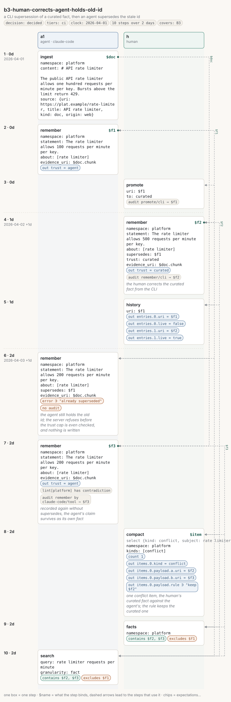

# b3-human-corrects-agent-holds-old-id

<!-- Generated by `memors-scenario book` from `internal/eval/testdata/scenarios/b3-human-corrects-agent-holds-old-id.yaml`. Do not edit: change the source and run `make scenario-docs`. -->

*a CLI supersession of a curated fact, then an agent supersedes the stale id*

- **Decision:** decided: the expectations are the wanted behaviour ([Open and decided](../decisions.md))
- **Tiers:** ci
- **Covers:** [B3 Human corrects, agent holds the old id](../catalogue.md#b3)
- **Actors:** `a1` agent, client `claude-code` · `h` human
- **Length:** 10 steps over 2 days from 2026-04-01
- **Source:** [`internal/eval/testdata/scenarios/b3-human-corrects-agent-holds-old-id.yaml`](https://github.com/kKEo/memors/blob/master/internal/eval/testdata/scenarios/b3-human-corrects-agent-holds-old-id.yaml)

## Why it exists

B3 — The human corrects, the agent holds the old id. An agent's fact is promoted to curated; the human then supersedes it from the CLI with a corrected curated fact. The agent, still holding the old address, calls remember with supersedes on it and is told the fact is already superseded (no audit row). Its claim must not vanish: recorded again without supersedes it lands as a conflict item against the human's fact, and the proposed rule keeps the curated one. The old fact stays in history only.

## Picture



[Open the picture on its own](b3-human-corrects-agent-holds-old-id.svg) to zoom. [Reading the picture](../pictures.md) explains lanes, chips and edges.

## Steps

| # | When | Actor | Op | What | Bind | Expects |
|---|---|---|---|---|---|---|
| 1 | Apr 1 (0d) | `a1` | `ingest` | \# API rate limiter | `$doc` |  |
| 2 | Apr 1 (0d) | `a1` | `remember` | The rate limiter allows 100 requests per minute per key. | `$f1` | out |
| 3 | Apr 1 (0d) | `h` | `promote` | $f1 |  | audit |
| 4 | Apr 2 (1d) | `h` | `remember` | The rate limiter allows 500 requests per minute per key.<br>*the human corrects the curated fact from the CLI* | `$f2` | out, audit |
| 5 | Apr 2 (1d) | `h` | `history` | $f1 |  | out |
| 6 | Apr 3 (2d) | `a1` | `remember` | The rate limiter allows 200 requests per minute per key.<br>*the agent still holds the old id; the server refuses before the trust cap is even checked, and nothing is written* |  | error, audit_none |
| 7 | Apr 3 (2d) | `a1` | `remember` | The rate limiter allows 200 requests per minute per key.<br>*recorded again without supersedes, the agent's claim survives as its own fact* | `$f3` | out, lint, audit |
| 8 | Apr 3 (2d) | `h` | `compact` | platform<br>*one conflict item, the human's curated fact against the agent's; the rule keeps the curated one* | `$item` | count, out, out_contains |
| 9 | Apr 3 (2d) | `h` | `facts` | platform |  | contains, excludes |
| 10 | Apr 3 (2d) | `a1` | `search` | rate limiter requests per minute |  | contains, excludes |

## Invariants

All 15 [invariants](../invariants.md) run after every step.

## Source

<details>
<summary>b3-human-corrects-agent-holds-old-id.yaml (105 lines)</summary>

```yaml
# B3 — The human corrects, the agent holds the old id. An agent's fact is
# promoted to curated; the human then supersedes it from the CLI with a
# corrected curated fact. The agent, still holding the old address, calls
# remember with supersedes on it and is told the fact is already superseded
# (no audit row). Its claim must not vanish: recorded again without supersedes
# it lands as a conflict item against the human's fact, and the proposed rule
# keeps the curated one. The old fact stays in history only.
name: b3-human-corrects-agent-holds-old-id
description: a CLI supersession of a curated fact, then an agent supersedes the stale id
decision: decided
tiers: [ci]
covers: [B3]
clock: 2026-04-01
actors:
  a1: {kind: agent, client: claude-code}
  h:  {kind: human}
steps:
  - at: 0d
    actor: a1
    op: ingest
    args:
      namespace: platform
      content: |
        # API rate limiter

        The public API rate limiter allows one hundred requests per minute per key. Bursts above the limit return 429.
      source: {uri: https://plat.example/rate-limiter, title: API rate limiter, kind: doc, origin: web}
    bind: doc

  - at: 0d
    actor: a1
    op: remember
    args: {namespace: platform, statement: "The rate limiter allows 100 requests per minute per key.", about: [rate limiter], evidence_uri: $doc.chunk}
    bind: f1
    expect:
      out: {trust: agent}

  - at: 0d
    actor: h
    op: promote
    args: {uri: $f1, to: curated}
    expect:
      audit: [{op: promote, channel: cli, target: $f1}]

  - at: 1d
    actor: h
    op: remember
    note: the human corrects the curated fact from the CLI
    args: {namespace: platform, statement: "The rate limiter allows 500 requests per minute per key.", about: [rate limiter], supersedes: $f1, trust: curated, evidence_uri: $doc.chunk}
    bind: f2
    expect:
      out: {trust: curated}
      audit: [{op: remember, channel: cli, target: $f2}]

  - at: 1d
    actor: h
    op: history
    args: {uri: $f1}
    expect:
      out: {entries.0.uri: $f1, entries.0.live: false, entries.1.uri: $f2, entries.1.live: true}

  - at: 2d
    actor: a1
    op: remember
    note: the agent still holds the old id; the server refuses before the trust cap is even checked, and nothing is written
    args: {namespace: platform, statement: "The rate limiter allows 200 requests per minute per key.", about: [rate limiter], supersedes: $f1, evidence_uri: $doc.chunk}
    expect:
      error: true
      error_contains: already superseded
      audit_none: true

  - at: 2d
    actor: a1
    op: remember
    note: recorded again without supersedes, the agent's claim survives as its own fact
    args: {namespace: platform, statement: "The rate limiter allows 200 requests per minute per key.", about: [rate limiter], evidence_uri: $doc.chunk}
    bind: f3
    expect:
      out: {trust: agent}
      audit: [{op: remember, actor: claude-code, channel: tool, target: $f3}]
      lint: {namespace: platform, has: [contradiction]}

  - at: 2d
    actor: h
    op: compact
    note: one conflict item, the human's curated fact against the agent's; the rule keeps the curated one
    args: {namespace: platform, kinds: [conflict]}
    select: {kind: conflict, subject: rate limiter}
    bind: item
    expect:
      count: 1
      out: {items.0.kind: conflict, items.0.payload.a.uri: $f2, items.0.payload.b.uri: $f3}
      out_contains: {items.0.payload.rule: "keep $f2"}

  - at: 2d
    actor: h
    op: facts
    args: {namespace: platform}
    expect: {contains: [$f2, $f3], excludes: [$f1]}

  - at: 2d
    actor: a1
    op: search
    args: {query: rate limiter requests per minute, granularity: fact}
    expect: {contains: [$f2, $f3], excludes: [$f1]}
```

</details>
