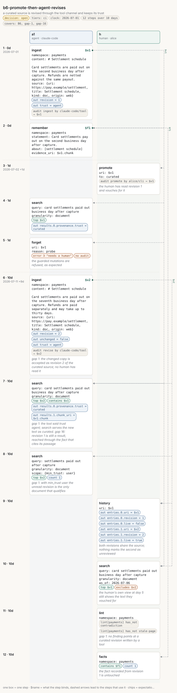

# b6-promote-then-agent-revises

<!-- Generated by `memors-scenario book` from `internal/eval/testdata/scenarios/b6-promote-then-agent-revises.yaml`. Do not edit: change the source and run `make scenario-docs`. -->

*a curated source is revised through the tool channel and keeps its trust*

- **Decision:** open: the expectations pin today's behaviour of a documented gap, not the behaviour anyone has chosen ([Open and decided](../decisions.md))
- **Tiers:** ci
- **Covers:** [B6 Promote, then an agent revises](../catalogue.md#b6) · [gap 1](../gaps.md#gap-1) · [gap 16](../gaps.md#gap-16)
- **Actors:** `a1` agent, client `claude-code` · `h` human, client `alice`
- **Length:** 12 steps over 10 days from 2026-07-01
- **Source:** [`internal/eval/testdata/scenarios/b6-promote-then-agent-revises.yaml`](https://github.com/kKEo/memors/blob/master/internal/eval/testdata/scenarios/b6-promote-then-agent-revises.yaml)

## Why it exists

B6 — Promote, then an agent revises. An agent ingests a web page; the human reads it, vouches for it and promotes it to curated from the CLI. Later the same agent fetches a changed copy of the page and re-ingests it through the tool channel. Forget, supersede and promote are guarded by the channel cap; revise is not (gap 1): the re-ingest succeeds, becomes revision 2 of the curated source, is served with curated trust and outranks the agent's own notes, while the tool's own result claims trust agent. The human's curation now covers text no human has read. Revision 1 also stays reachable through the fact that cites its passage (gap 16). The steps marked with a gap pin this.

## Picture



[Open the picture on its own](b6-promote-then-agent-revises.svg) to zoom. [Reading the picture](../pictures.md) explains lanes, chips and edges.

## Steps

| # | When | Actor | Op | What | Bind | Expects |
|---|---|---|---|---|---|---|
| 1 | Jul 1 (0d) | `a1` | `ingest` | \# Settlement schedule | `$v1` | out, audit |
| 2 | Jul 1 (0d) | `a1` | `remember` | Card settlements pay out on the second business day after c… | `$f1` |  |
| 3 | Jul 2 (1d) | `h` | `promote` | $v1<br>*the human has read revision 1 and vouches for it* |  | audit |
| 4 | Jul 2 (1d) | `a1` | `search` | card settlements paid out business day after capture |  | top, out |
| 5 | Jul 2 (1d) | `a1` | `forget` | $v1<br>*the guarded mutations are refused, as expected* |  | error, audit_none |
| 6 | Jul 11 (10d) | `a1` | `ingest` | \# Settlement schedule<br>*gap 1: the changed copy is accepted as revision 2 of the curated source; no human has read it* | `$v2` | out, audit |
| 7 | Jul 11 (10d) | `a1` | `search` | card settlements paid out business day after capture<br>*gap 1: the tool said trust agent; search serves the new text as curated. gap 16: revision 1 is still a result, reached through the fact that cites its passage* |  | top, contains, out |
| 8 | Jul 11 (10d) | `a1` | `search` | settlements paid out after capture<br>*gap 1: with min\_trust user the unread revision is the only document that qualifies* |  | top, count |
| 9 | Jul 11 (10d) | `h` | `history` | $v1<br>*both revisions share the source; nothing marks the second as unreviewed* |  | out |
| 10 | Jul 11 (10d) | `h` | `search` | card settlements paid out business day after capture<br>*the human's own view at day 5 still shows the text they vouched for* |  | top, excludes |
| 11 | Jul 11 (10d) | `h` | `lint` | payments<br>*gap 1: no finding points at a curated revision written by a tool* |  | lint |
| 12 | Jul 11 (10d) | `h` | `facts` | payments<br>*the fact recorded from revision 1 is untouched* |  | contains, count |

## Invariants

All 15 [invariants](../invariants.md) run after every step.

## Source

<details>
<summary>b6-promote-then-agent-revises.yaml (129 lines)</summary>

```yaml
# B6 — Promote, then an agent revises. An agent ingests a web page; the human
# reads it, vouches for it and promotes it to curated from the CLI. Later the
# same agent fetches a changed copy of the page and re-ingests it through the
# tool channel. Forget, supersede and promote are guarded by the channel cap;
# revise is not (gap 1): the re-ingest succeeds, becomes revision 2 of the
# curated source, is served with curated trust and outranks the agent's own
# notes, while the tool's own result claims trust agent. The human's curation
# now covers text no human has read. Revision 1 also stays reachable through
# the fact that cites its passage (gap 16). The steps marked with a gap pin this.
name: b6-promote-then-agent-revises
description: a curated source is revised through the tool channel and keeps its trust
decision: open
tiers: [ci]
covers: [B6, gap-1, gap-16]
clock: 2026-07-01
actors:
  a1: {kind: agent, client: claude-code}
  h:  {kind: human, client: alice}
steps:
  - at: 0d
    actor: a1
    op: ingest
    args:
      namespace: payments
      content: |
        # Settlement schedule

        Card settlements are paid out on the second business day after capture. Refunds are netted against the same payout.
      source: {uri: https://pay.example/settlement, title: Settlement schedule, kind: doc, origin: web}
    bind: v1
    expect:
      out: {revision: 1, trust: agent}
      audit: [{op: ingest, actor: claude-code, channel: tool, target: $v1}]

  - at: 0d
    actor: a1
    op: remember
    args: {namespace: payments, statement: "Card settlements pay out on the second business day after capture.", about: [settlement schedule], evidence_uri: $v1.chunk}
    bind: f1

  - at: 1d
    actor: h
    op: promote
    note: the human has read revision 1 and vouches for it
    args: {uri: $v1, to: curated}
    expect:
      audit: [{op: promote, actor: alice, channel: cli, target: $v1}]

  - at: 1d
    actor: a1
    op: search
    args: {query: card settlements paid out business day after capture, granularity: document}
    expect:
      top: [$v1]
      out: {results.0.provenance.trust: curated}

  - at: 1d
    actor: a1
    op: forget
    note: the guarded mutations are refused, as expected
    args: {uri: $v1, reason: "probe"}
    expect: {error: true, error_contains: needs a human, audit_none: true}

  - at: 10d
    actor: a1
    op: ingest
    note: "gap 1: the changed copy is accepted as revision 2 of the curated source; no human has read it"
    args:
      namespace: payments
      content: |
        # Settlement schedule

        Card settlements are paid out on the seventh business day after capture. Refunds are paid separately and may take up to thirty days.
      source: {uri: https://pay.example/settlement, title: Settlement schedule, kind: doc, origin: web}
    bind: v2
    expect:
      out: {revision: 2, unchanged: false, trust: agent}
      audit: [{op: revise, actor: claude-code, channel: tool, target: $v2}]

  - at: 10d
    actor: a1
    op: search
    note: "gap 1: the tool said trust agent; search serves the new text as curated. gap 16: revision 1 is still a result, reached through the fact that cites its passage"
    args: {query: card settlements paid out business day after capture, granularity: document}
    expect:
      top: [$v2]
      contains: [$v1]
      out: {results.0.provenance.trust: curated, results.1.chunk_uri: $v1.chunk}

  - at: 10d
    actor: a1
    op: search
    note: "gap 1: with min_trust user the unread revision is the only document that qualifies"
    args: {query: settlements paid out after capture, granularity: document, scope: {min_trust: user}}
    expect:
      top: [$v2]
      count: 1

  - at: 10d
    actor: h
    op: history
    note: both revisions share the source; nothing marks the second as unreviewed
    args: {uri: $v1}
    expect:
      out: {entries.0.uri: $v1, entries.0.revision: 1, entries.0.live: false, entries.1.uri: $v2, entries.1.revision: 2, entries.1.live: true}

  - at: 10d
    actor: h
    op: search
    note: the human's own view at day 5 still shows the text they vouched for
    args: {query: card settlements paid out business day after capture, granularity: document, as_of: "2026-07-06"}
    expect:
      top: [$v1]
      excludes: [$v2]

  - at: 10d
    actor: h
    op: lint
    note: "gap 1: no finding points at a curated revision written by a tool"
    args: {namespace: payments}
    expect:
      lint: {namespace: payments, has_not: [contradiction, stale-page]}

  - at: 10d
    actor: h
    op: facts
    note: the fact recorded from revision 1 is untouched
    args: {namespace: payments}
    expect: {contains: [$f1], count: 1}
```

</details>
