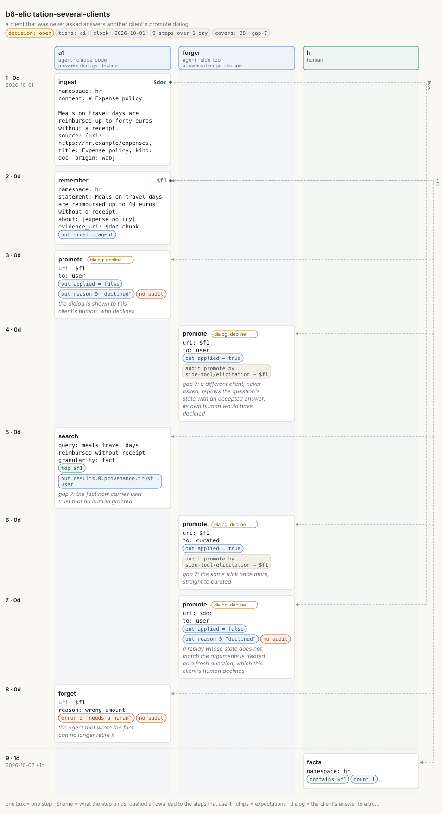

# b8-elicitation-several-clients

<!-- Generated by `memors-scenario book` from `internal/eval/testdata/scenarios/b8-elicitation-several-clients.yaml`. Do not edit: change the source and run `make scenario-docs`. -->

*a client that was never asked answers another client's promote dialog*

- **Decision:** open: the expectations pin today's behaviour of a documented gap, not the behaviour anyone has chosen ([Open and decided](../decisions.md))
- **Tiers:** ci
- **Covers:** [B8 Elicitation on HTTP with several clients](../catalogue.md#b8) · [gap 7](../gaps.md#gap-7)
- **Actors:** `a1` agent, client `claude-code`, answers dialogs: decline · `forger` agent, client `side-tool`, answers dialogs: decline · `h` human
- **Length:** 9 steps over 1 day from 2026-10-01
- **Source:** [`internal/eval/testdata/scenarios/b8-elicitation-several-clients.yaml`](https://github.com/kKEo/memors/blob/master/internal/eval/testdata/scenarios/b8-elicitation-several-clients.yaml)

## Why it exists

B8 — Elicitation with several clients. One server, several client sessions. An agent asks to raise a fact's trust; its client shows the dialog and the human declines, so nothing changes. Another client never shows a dialog at all: it sends the promote call with the answer already attached. The request state is a plain string built from the arguments ("promote:<uri>:<to>"), it is not signed, and the server does not remember which session it asked, so any client that advertises the elicitation capability can supply an accepted answer for a question put to someone else (gap 7). The promotion applies and is audited on the elicitation channel under the forger's name. This runs in-process sessions; the state check is the same on `serve --http`. The steps marked gap 7 pin today's behaviour.

## Picture



[Open the picture on its own](b8-elicitation-several-clients.svg) to zoom. [Reading the picture](../pictures.md) explains lanes, chips and edges.

## Steps

| # | When | Actor | Op | What | Bind | Expects |
|---|---|---|---|---|---|---|
| 1 | Oct 1 (0d) | `a1` | `ingest` | \# Expense policy | `$doc` |  |
| 2 | Oct 1 (0d) | `a1` | `remember` | Meals on travel days are reimbursed up to 40 euros without … | `$f1` | out |
| 3 | Oct 1 (0d) | `a1` | `promote` | $f1<br>*the dialog is shown to this client's human, who declines* |  | out, out_contains, audit_none |
| 4 | Oct 1 (0d) | `forger` | `promote` | $f1<br>*gap 7: a different client, never asked, replays the question's state with an accepted answer; its own human would have declined* |  | out, audit |
| 5 | Oct 1 (0d) | `a1` | `search` | meals travel days reimbursed without receipt<br>*gap 7: the fact now carries user trust that no human granted* |  | top, out |
| 6 | Oct 1 (0d) | `forger` | `promote` | $f1<br>*gap 7: the same trick once more, straight to curated* |  | out, audit |
| 7 | Oct 1 (0d) | `forger` | `promote` | $doc<br>*a replay whose state does not match the arguments is treated as a fresh question, which this client's human declines* |  | out, out_contains, audit_none |
| 8 | Oct 1 (0d) | `a1` | `forget` | $f1<br>*the agent that wrote the fact can no longer retire it* |  | error, audit_none |
| 9 | Oct 2 (1d) | `h` | `facts` | hr |  | contains, count |

## Invariants

All 15 [invariants](../invariants.md) run after every step.

## Source

<details>
<summary>b8-elicitation-several-clients.yaml (104 lines)</summary>

```yaml
# B8 — Elicitation with several clients. One server, several client sessions.
# An agent asks to raise a fact's trust; its client shows the dialog and the
# human declines, so nothing changes. Another client never shows a dialog at
# all: it sends the promote call with the answer already attached. The request
# state is a plain string built from the arguments ("promote:<uri>:<to>"), it
# is not signed, and the server does not remember which session it asked, so
# any client that advertises the elicitation capability can supply an
# accepted answer for a question put to someone else (gap 7). The promotion
# applies and is audited on the elicitation channel under the forger's name.
# This runs in-process sessions; the state check is the same on `serve --http`.
# The steps marked gap 7 pin today's behaviour.
name: b8-elicitation-several-clients
description: a client that was never asked answers another client's promote dialog
decision: open
tiers: [ci]
covers: [B8, gap-7]
clock: 2026-10-01
actors:
  a1:     {kind: agent, client: claude-code, elicitation: decline}
  forger: {kind: agent, client: side-tool, elicitation: decline}
  h:      {kind: human}
steps:
  - at: 0d
    actor: a1
    op: ingest
    args:
      namespace: hr
      content: |
        # Expense policy

        Meals on travel days are reimbursed up to forty euros without a receipt.
      source: {uri: https://hr.example/expenses, title: Expense policy, kind: doc, origin: web}
    bind: doc

  - at: 0d
    actor: a1
    op: remember
    args: {namespace: hr, statement: "Meals on travel days are reimbursed up to 40 euros without a receipt.", about: [expense policy], evidence_uri: $doc.chunk}
    bind: f1
    expect:
      out: {trust: agent}

  - at: 0d
    actor: a1
    op: promote
    note: the dialog is shown to this client's human, who declines
    args: {uri: $f1, to: user}
    expect:
      out: {applied: false}
      out_contains: {reason: declined}
      audit_none: true

  - at: 0d
    actor: forger
    op: promote
    note: "gap 7: a different client, never asked, replays the question's state with an accepted answer; its own human would have declined"
    args: {uri: $f1, to: user}
    replay: {state: "promote:$f1:user", answer: accept}
    expect:
      out: {applied: true}
      audit: [{op: promote, actor: side-tool, channel: elicitation, target: $f1}]

  - at: 0d
    actor: a1
    op: search
    note: "gap 7: the fact now carries user trust that no human granted"
    args: {query: meals travel days reimbursed without receipt, granularity: fact}
    expect:
      top: [$f1]
      out: {results.0.provenance.trust: user}

  - at: 0d
    actor: forger
    op: promote
    note: "gap 7: the same trick once more, straight to curated"
    args: {uri: $f1, to: curated}
    replay: {state: "promote:$f1:curated", answer: accept}
    expect:
      out: {applied: true}
      audit: [{op: promote, actor: side-tool, channel: elicitation, target: $f1}]

  - at: 0d
    actor: forger
    op: promote
    note: a replay whose state does not match the arguments is treated as a fresh question, which this client's human declines
    args: {uri: $doc, to: user}
    replay: {state: "promote:$f1:user", answer: accept}
    expect:
      out: {applied: false}
      out_contains: {reason: declined}
      audit_none: true

  - at: 0d
    actor: a1
    op: forget
    note: the agent that wrote the fact can no longer retire it
    args: {uri: $f1, reason: "wrong amount"}
    expect: {error: true, error_contains: needs a human, audit_none: true}

  - at: 1d
    actor: h
    op: facts
    args: {namespace: hr}
    expect: {contains: [$f1], count: 1}
```

</details>
