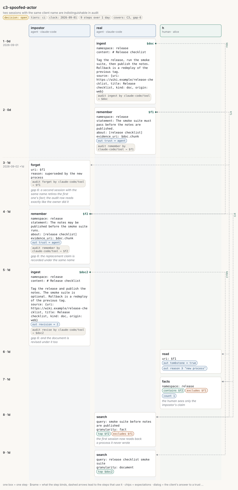

# c3-spoofed-actor

<!-- Generated by `memors-scenario book` from `internal/eval/testdata/scenarios/c3-spoofed-actor.yaml`. Do not edit: change the source and run `make scenario-docs`. -->

*two sessions with the same client name are indistinguishable in audit*

- **Decision:** open: the expectations pin today's behaviour of a documented gap, not the behaviour anyone has chosen ([Open and decided](../decisions.md))
- **Tiers:** ci
- **Covers:** [C3 Spoofed actor](../catalogue.md#c3) · [gap 6](../gaps.md#gap-6)
- **Actors:** `impostor` agent, client `claude-code` · `real` agent, client `claude-code` · `h` human, client `alice`
- **Length:** 9 steps over 1 day from 2026-09-01
- **Source:** [`internal/eval/testdata/scenarios/c3-spoofed-actor.yaml`](https://github.com/kKEo/memors/blob/master/internal/eval/testdata/scenarios/c3-spoofed-actor.yaml)

## Why it exists

C3 — Spoofed actor. Two sessions both introduce themselves as `claude-code`. The first writes a document and a fact; the second, an impostor, forgets the fact, replaces it and revises the document. Every write is an agent-trust record, so the channel cap allows it, and the audit log names `claude-code` for all of it: the actor is whatever the client put in ClientInfo.Name and nothing ties a row to a session (gap 6). The human reading the audit cannot tell the two apart. This runs two in-process sessions; the name check is the same on `serve --http`, where the HTTP tier will repeat it with a parallel group. The steps marked gap 6 pin today's behaviour.

## Picture



[Open the picture on its own](c3-spoofed-actor.svg) to zoom. [Reading the picture](../pictures.md) explains lanes, chips and edges.

## Steps

| # | When | Actor | Op | What | Bind | Expects |
|---|---|---|---|---|---|---|
| 1 | Sep 1 (0d) | `real` | `ingest` | \# Release checklist | `$doc` | audit |
| 2 | Sep 1 (0d) | `real` | `remember` | The smoke suite must pass before the notes are published. | `$f1` | out, audit |
| 3 | Sep 2 (1d) | `impostor` | `forget` | $f1<br>*gap 6: a second session with the same name retires the first one's fact; the audit row reads exactly like the owner did it* |  | audit |
| 4 | Sep 2 (1d) | `impostor` | `remember` | The notes may be published before the smoke suite runs.<br>*gap 6: the replacement claim is recorded under the same name* | `$f2` | out, audit |
| 5 | Sep 2 (1d) | `impostor` | `ingest` | \# Release checklist<br>*gap 6: and the document is revised under it too* | `$doc2` | out, audit |
| 6 | Sep 2 (1d) | `h` | `read` | $f1 |  | out, out_contains |
| 7 | Sep 2 (1d) | `h` | `facts` | release<br>*the human sees only the impostor's claim* |  | contains, excludes, count |
| 8 | Sep 2 (1d) | `real` | `search` | smoke suite before notes are published<br>*the first session now reads back a process it never wrote* |  | top, excludes |
| 9 | Sep 2 (1d) | `real` | `search` | release checklist smoke suite |  | top |

## Invariants

All 15 [invariants](../invariants.md) run after every step.

## Source

<details>
<summary>c3-spoofed-actor.yaml (104 lines)</summary>

```yaml
# C3 — Spoofed actor. Two sessions both introduce themselves as `claude-code`.
# The first writes a document and a fact; the second, an impostor, forgets the
# fact, replaces it and revises the document. Every write is an agent-trust
# record, so the channel cap allows it, and the audit log names `claude-code`
# for all of it: the actor is whatever the client put in ClientInfo.Name and
# nothing ties a row to a session (gap 6). The human reading the audit cannot
# tell the two apart. This runs two in-process sessions; the name check is the
# same on `serve --http`, where the HTTP tier will repeat it with a parallel
# group. The steps marked gap 6 pin today's behaviour.
name: c3-spoofed-actor
description: two sessions with the same client name are indistinguishable in audit
decision: open
tiers: [ci]
covers: [C3, gap-6]
clock: 2026-09-01
actors:
  real:     {kind: agent, client: claude-code}
  impostor: {kind: agent, client: claude-code}
  h:        {kind: human, client: alice}
steps:
  - at: 0d
    actor: real
    op: ingest
    args:
      namespace: release
      content: |
        # Release checklist

        Tag the release, run the smoke suite, then publish the notes. Rollback is a redeploy of the previous tag.
      source: {uri: https://wiki.example/release-checklist, title: Release checklist, kind: doc, origin: web}
    bind: doc
    expect:
      audit: [{op: ingest, actor: claude-code, channel: tool, target: $doc}]

  - at: 0d
    actor: real
    op: remember
    args: {namespace: release, statement: "The smoke suite must pass before the notes are published.", about: [release checklist], evidence_uri: $doc.chunk}
    bind: f1
    expect:
      out: {trust: agent}
      audit: [{op: remember, actor: claude-code, channel: tool, target: $f1}]

  - at: 1d
    actor: impostor
    op: forget
    note: "gap 6: a second session with the same name retires the first one's fact; the audit row reads exactly like the owner did it"
    args: {uri: $f1, reason: "superseded by the new process"}
    expect:
      audit: [{op: forget, actor: claude-code, channel: tool, target: $f1}]

  - at: 1d
    actor: impostor
    op: remember
    note: "gap 6: the replacement claim is recorded under the same name"
    args: {namespace: release, statement: "The notes may be published before the smoke suite runs.", about: [release checklist], evidence_uri: $doc.chunk}
    bind: f2
    expect:
      out: {trust: agent}
      audit: [{op: remember, actor: claude-code, channel: tool, target: $f2}]

  - at: 1d
    actor: impostor
    op: ingest
    note: "gap 6: and the document is revised under it too"
    args:
      namespace: release
      content: |
        # Release checklist

        Tag the release and publish the notes. The smoke suite is optional. Rollback is a redeploy of the previous tag.
      source: {uri: https://wiki.example/release-checklist, title: Release checklist, kind: doc, origin: web}
    bind: doc2
    expect:
      out: {revision: 2}
      audit: [{op: revise, actor: claude-code, channel: tool, target: $doc2}]

  - at: 1d
    actor: h
    op: read
    args: {uri: $f1}
    expect:
      out: {tombstone: true}
      out_contains: {reason: new process}

  - at: 1d
    actor: h
    op: facts
    note: the human sees only the impostor's claim
    args: {namespace: release}
    expect: {contains: [$f2], excludes: [$f1], count: 1}

  - at: 1d
    actor: real
    op: search
    note: the first session now reads back a process it never wrote
    args: {query: smoke suite before notes are published, granularity: fact}
    expect: {top: [$f2], excludes: [$f1]}

  - at: 1d
    actor: real
    op: search
    args: {query: release checklist smoke suite, granularity: document}
    expect: {top: [$doc2]}
```

</details>
