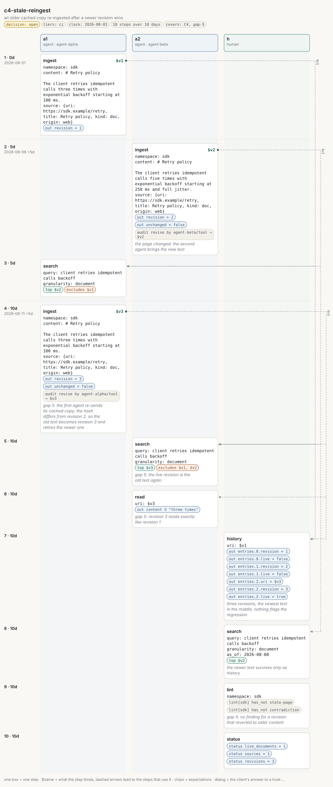

# c4-stale-reingest

<!-- Generated by `memors-scenario book` from `internal/eval/testdata/scenarios/c4-stale-reingest.yaml`. Do not edit: change the source and run `make scenario-docs`. -->

*an older cached copy re-ingested after a newer revision wins*

- **Decision:** open: the expectations pin today's behaviour of a documented gap, not the behaviour anyone has chosen ([Open and decided](../decisions.md))
- **Tiers:** ci
- **Covers:** [C4 Stale re-ingest](../catalogue.md#c4) · [gap 5](../gaps.md#gap-5)
- **Actors:** `a1` agent, client `agent-alpha` · `a2` agent, client `agent-beta` · `h` human
- **Length:** 10 steps over 10 days from 2026-08-01
- **Source:** [`internal/eval/testdata/scenarios/c4-stale-reingest.yaml`](https://github.com/kKEo/memors/blob/master/internal/eval/testdata/scenarios/c4-stale-reingest.yaml)

## Why it exists

C4 — Stale re-ingest. Two agents hold copies of the same page. The first ingests it; the page changes and the second agent ingests the new text as revision 2. Days later the first agent, working from its old cache, ingests its copy again. The store only compares the hash with the live revision, so the old text becomes revision 3 and the newer text is retired (gap 5): the knowledge base moved backwards and nothing says so. The steps marked gap 5 pin that until the owner decides whether a re-ingest whose content matches an earlier revision should be a no-op, a warning, or a revision as today.

## Picture



[Open the picture on its own](c4-stale-reingest.svg) to zoom. [Reading the picture](../pictures.md) explains lanes, chips and edges.

## Steps

| # | When | Actor | Op | What | Bind | Expects |
|---|---|---|---|---|---|---|
| 1 | Aug 1 (0d) | `a1` | `ingest` | \# Retry policy | `$v1` | out |
| 2 | Aug 6 (5d) | `a2` | `ingest` | \# Retry policy<br>*the page changed; the second agent brings the new text* | `$v2` | out, audit |
| 3 | Aug 6 (5d) | `a1` | `search` | client retries idempotent calls backoff |  | top, excludes |
| 4 | Aug 11 (10d) | `a1` | `ingest` | \# Retry policy<br>*gap 5: the first agent re-sends its cached copy; the hash differs from revision 2, so the old text becomes revision 3 and retires the newer one* | `$v3` | out, audit |
| 5 | Aug 11 (10d) | `a2` | `search` | client retries idempotent calls backoff<br>*gap 5: the live revision is the old text again* |  | top, excludes |
| 6 | Aug 11 (10d) | `a2` | `read` | $v3<br>*gap 5: revision 3 reads exactly like revision 1* |  | out_contains |
| 7 | Aug 11 (10d) | `h` | `history` | $v1<br>*three revisions, the newest text in the middle, nothing flags the regression* |  | out |
| 8 | Aug 11 (10d) | `h` | `search` | client retries idempotent calls backoff<br>*the newer text survives only as history* |  | top |
| 9 | Aug 11 (10d) | `h` | `lint` | sdk<br>*gap 5: no finding for a revision that reverted to older content* |  | lint |
| 10 | Aug 11 (10d) | `h` | `status` |  |  | status |

## Invariants

All 15 [invariants](../invariants.md) run after every step.

## Source

<details>
<summary>c4-stale-reingest.yaml (117 lines)</summary>

```yaml
# C4 — Stale re-ingest. Two agents hold copies of the same page. The first
# ingests it; the page changes and the second agent ingests the new text as
# revision 2. Days later the first agent, working from its old cache, ingests
# its copy again. The store only compares the hash with the live revision, so
# the old text becomes revision 3 and the newer text is retired (gap 5): the
# knowledge base moved backwards and nothing says so. The steps marked gap 5
# pin that until the owner decides whether a re-ingest whose content matches
# an earlier revision should be a no-op, a warning, or a revision as today.
name: c4-stale-reingest
description: an older cached copy re-ingested after a newer revision wins
decision: open
tiers: [ci]
covers: [C4, gap-5]
clock: 2026-08-01
actors:
  a1: {kind: agent, client: agent-alpha}
  a2: {kind: agent, client: agent-beta}
  h:  {kind: human}
steps:
  - at: 0d
    actor: a1
    op: ingest
    args:
      namespace: sdk
      content: |
        # Retry policy

        The client retries idempotent calls three times with exponential backoff starting at 100 ms.
      source: {uri: https://sdk.example/retry, title: Retry policy, kind: doc, origin: web}
    bind: v1
    expect:
      out: {revision: 1}

  - at: 5d
    actor: a2
    op: ingest
    note: the page changed; the second agent brings the new text
    args:
      namespace: sdk
      content: |
        # Retry policy

        The client retries idempotent calls five times with exponential backoff starting at 250 ms and full jitter.
      source: {uri: https://sdk.example/retry, title: Retry policy, kind: doc, origin: web}
    bind: v2
    expect:
      out: {revision: 2, unchanged: false}
      audit: [{op: revise, actor: agent-beta, channel: tool, target: $v2}]

  - at: 5d
    actor: a1
    op: search
    args: {query: client retries idempotent calls backoff, granularity: document}
    expect: {top: [$v2], excludes: [$v1]}

  - at: 10d
    actor: a1
    op: ingest
    note: "gap 5: the first agent re-sends its cached copy; the hash differs from revision 2, so the old text becomes revision 3 and retires the newer one"
    args:
      namespace: sdk
      content: |
        # Retry policy

        The client retries idempotent calls three times with exponential backoff starting at 100 ms.
      source: {uri: https://sdk.example/retry, title: Retry policy, kind: doc, origin: web}
    bind: v3
    expect:
      out: {revision: 3, unchanged: false}
      audit: [{op: revise, actor: agent-alpha, channel: tool, target: $v3}]

  - at: 10d
    actor: a2
    op: search
    note: "gap 5: the live revision is the old text again"
    args: {query: client retries idempotent calls backoff, granularity: document}
    expect:
      top: [$v3]
      excludes: [$v1, $v2]

  - at: 10d
    actor: a2
    op: read
    note: "gap 5: revision 3 reads exactly like revision 1"
    args: {uri: $v3}
    expect:
      out_contains: {content: three times}

  - at: 10d
    actor: h
    op: history
    note: three revisions, the newest text in the middle, nothing flags the regression
    args: {uri: $v1}
    expect:
      out: {entries.0.revision: 1, entries.0.live: false, entries.1.revision: 2, entries.1.live: false, entries.2.uri: $v3, entries.2.revision: 3, entries.2.live: true}

  - at: 10d
    actor: h
    op: search
    note: the newer text survives only as history
    args: {query: client retries idempotent calls backoff, granularity: document, as_of: "2026-08-08"}
    expect: {top: [$v2]}

  - at: 10d
    actor: h
    op: lint
    note: "gap 5: no finding for a revision that reverted to older content"
    args: {namespace: sdk}
    expect:
      lint: {namespace: sdk, has_not: [stale-page, contradiction]}

  - at: 10d
    actor: h
    op: status
    args: {}
    expect:
      status: {live_documents: 1, sources: 1, revisions: 3}
```

</details>
