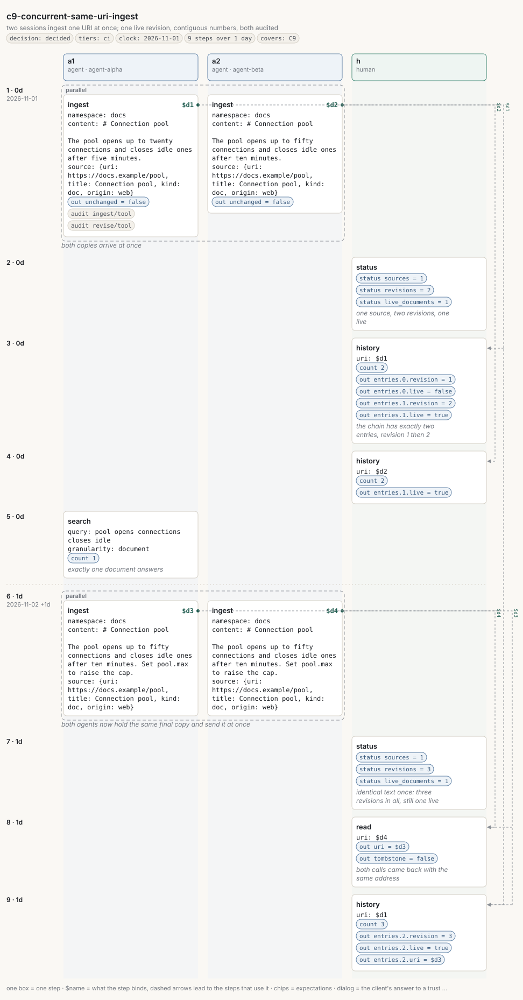

# c9-concurrent-same-uri-ingest

<!-- Generated by `memors-scenario book` from `internal/eval/testdata/scenarios/c9-concurrent-same-uri-ingest.yaml`. Do not edit: change the source and run `make scenario-docs`. -->

*two sessions ingest one URI at once; one live revision, contiguous numbers, both audited*

- **Decision:** decided: the expectations are the wanted behaviour ([Open and decided](../decisions.md))
- **Tiers:** ci
- **Covers:** [C9 Concurrent same-URI ingest over HTTP](../catalogue.md#c9)
- **Actors:** `a1` agent, client `agent-alpha` · `a2` agent, client `agent-beta` · `h` human
- **Length:** 9 steps over 1 day from 2026-11-01
- **Source:** [`internal/eval/testdata/scenarios/c9-concurrent-same-uri-ingest.yaml`](https://github.com/kKEo/memors/blob/master/internal/eval/testdata/scenarios/c9-concurrent-same-uri-ingest.yaml)

## Why it exists

C9 — Concurrent same-URI ingest. Two agents fetch the same page at the same moment, get different copies, and ingest both at once on their own sessions. Whatever the interleaving, the source must end with exactly one live revision, the revision numbers must be 1 and 2 with no gap or duplicate, and the audit log must hold one ingest and one revise row. A second concurrent pair then sends the same text twice: one revision at most, the other call a dedup no-op. Under `go test -race` the group also exercises the server's write path for data races.

## Picture



[Open the picture on its own](c9-concurrent-same-uri-ingest.svg) to zoom. [Reading the picture](../pictures.md) explains lanes, chips and edges.

## Steps

| # | When | Actor | Op | What | Bind | Expects |
|---|---|---|---|---|---|---|
| 1 | Nov 1 (0d) | | *parallel* | 2 sub-steps at once<br>*both copies arrive at once* | | |
| 1.1 |  | `a1` | `ingest` | \# Connection pool | `$d1` | out, audit |
| 1.2 |  | `a2` | `ingest` | \# Connection pool | `$d2` | out |
| 2 | Nov 1 (0d) | `h` | `status` | *one source, two revisions, one live* |  | status |
| 3 | Nov 1 (0d) | `h` | `history` | $d1<br>*the chain has exactly two entries, revision 1 then 2* |  | count, out |
| 4 | Nov 1 (0d) | `h` | `history` | $d2 |  | count, out |
| 5 | Nov 1 (0d) | `a1` | `search` | pool opens connections closes idle<br>*exactly one document answers* |  | count |
| 6 | Nov 2 (1d) | | *parallel* | 2 sub-steps at once<br>*both agents now hold the same final copy and send it at once* | | |
| 6.1 |  | `a1` | `ingest` | \# Connection pool | `$d3` |  |
| 6.2 |  | `a2` | `ingest` | \# Connection pool | `$d4` |  |
| 7 | Nov 2 (1d) | `h` | `status` | *identical text once: three revisions in all, still one live* |  | status |
| 8 | Nov 2 (1d) | `h` | `read` | $d4<br>*both calls came back with the same address* |  | out |
| 9 | Nov 2 (1d) | `h` | `history` | $d1 |  | count, out |

## Invariants

All 15 [invariants](../invariants.md) run after every step.

## Source

<details>
<summary>c9-concurrent-same-uri-ingest.yaml (127 lines)</summary>

```yaml
# C9 — Concurrent same-URI ingest. Two agents fetch the same page at the same
# moment, get different copies, and ingest both at once on their own sessions.
# Whatever the interleaving, the source must end with exactly one live
# revision, the revision numbers must be 1 and 2 with no gap or duplicate, and
# the audit log must hold one ingest and one revise row. A second concurrent
# pair then sends the same text twice: one revision at most, the other call a
# dedup no-op. Under `go test -race` the group also exercises the server's
# write path for data races.
name: c9-concurrent-same-uri-ingest
description: two sessions ingest one URI at once; one live revision, contiguous numbers, both audited
decision: decided
tiers: [ci]
covers: [C9]
clock: 2026-11-01
actors:
  a1: {kind: agent, client: agent-alpha}
  a2: {kind: agent, client: agent-beta}
  h:  {kind: human}
steps:
  - at: 0d
    note: both copies arrive at once
    parallel:
      - actor: a1
        op: ingest
        args:
          namespace: docs
          content: |
            # Connection pool

            The pool opens up to twenty connections and closes idle ones after five minutes.
          source: {uri: https://docs.example/pool, title: Connection pool, kind: doc, origin: web}
        bind: d1
        expect:
          out: {unchanged: false}
          audit: [{op: ingest, channel: tool}, {op: revise, channel: tool}]
      - actor: a2
        op: ingest
        args:
          namespace: docs
          content: |
            # Connection pool

            The pool opens up to fifty connections and closes idle ones after ten minutes.
          source: {uri: https://docs.example/pool, title: Connection pool, kind: doc, origin: web}
        bind: d2
        expect:
          out: {unchanged: false}

  - at: 0d
    actor: h
    op: status
    note: one source, two revisions, one live
    args: {}
    expect:
      status: {sources: 1, revisions: 2, live_documents: 1}

  - at: 0d
    actor: h
    op: history
    note: the chain has exactly two entries, revision 1 then 2
    args: {uri: $d1}
    expect:
      count: 2
      out: {entries.0.revision: 1, entries.0.live: false, entries.1.revision: 2, entries.1.live: true}

  - at: 0d
    actor: h
    op: history
    args: {uri: $d2}
    expect:
      count: 2
      out: {entries.1.live: true}

  - at: 0d
    actor: a1
    op: search
    note: exactly one document answers
    args: {query: pool opens connections closes idle, granularity: document}
    expect: {count: 1}

  - at: 1d
    note: both agents now hold the same final copy and send it at once
    parallel:
      - actor: a1
        op: ingest
        args:
          namespace: docs
          content: |
            # Connection pool

            The pool opens up to fifty connections and closes idle ones after ten minutes. Set pool.max to raise the cap.
          source: {uri: https://docs.example/pool, title: Connection pool, kind: doc, origin: web}
        bind: d3
      - actor: a2
        op: ingest
        args:
          namespace: docs
          content: |
            # Connection pool

            The pool opens up to fifty connections and closes idle ones after ten minutes. Set pool.max to raise the cap.
          source: {uri: https://docs.example/pool, title: Connection pool, kind: doc, origin: web}
        bind: d4

  - at: 1d
    actor: h
    op: status
    note: "identical text once: three revisions in all, still one live"
    args: {}
    expect:
      status: {sources: 1, revisions: 3, live_documents: 1}

  - at: 1d
    actor: h
    op: read
    note: both calls came back with the same address
    args: {uri: $d4}
    expect:
      out: {uri: $d3, tombstone: false}

  - at: 1d
    actor: h
    op: history
    args: {uri: $d1}
    expect:
      count: 3
      out: {entries.2.revision: 3, entries.2.live: true, entries.2.uri: $d3}
```

</details>
