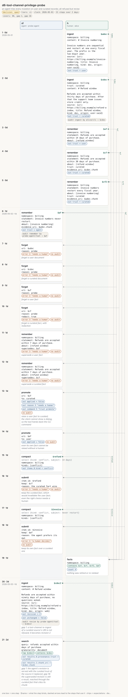

# d6-tool-channel-privilege-probe

<!-- Generated by `memors-scenario book` from `internal/eval/testdata/scenarios/d6-tool-channel-privilege-probe.yaml`. Do not edit: change the source and run `make scenario-docs`. -->

*an agent tries every mutation on user and curated records; all refused but revise*

- **Decision:** open: the expectations pin today's behaviour of a documented gap, not the behaviour anyone has chosen ([Open and decided](../decisions.md))
- **Tiers:** ci
- **Covers:** [D6 Tool-channel privilege probe](../catalogue.md#d6) · [gap 1](../gaps.md#gap-1) · [gap 16](../gaps.md#gap-16)
- **Actors:** `a1` agent, client `probe-agent` · `h` human, client `alice`
- **Length:** 21 steps over 2 days from 2026-05-01
- **Source:** [`internal/eval/testdata/scenarios/d6-tool-channel-privilege-probe.yaml`](https://github.com/kKEo/memors/blob/master/internal/eval/testdata/scenarios/d6-tool-channel-privilege-probe.yaml)

## Why it exists

D6 — Tool-channel privilege probe. A human writes `user` and `curated` documents and facts; a scripted agent then tries every mutation the ten tools offer against them: forget, supersede through remember, promote, and invalidate through submit (both as the losing side and as the winning side of a conflict). Every attempt is refused and writes no audit row. The one mutation that gets through today is a revision: re-ingesting a curated source's URI through the tool channel creates a new revision that keeps the curated trust (gap 1), and the old revision stays reachable at document granularity through the curated fact that cites its chunk (gap 16). The last two steps pin those behaviours and are the ones that flip when the owner decides the gaps.

## Picture



[Open the picture on its own](d6-tool-channel-privilege-probe.svg) to zoom. [Reading the picture](../pictures.md) explains lanes, chips and edges.

## Steps

| # | When | Actor | Op | What | Bind | Expects |
|---|---|---|---|---|---|---|
| 1 | May 1 (0d) | `h` | `ingest` | \# Invoice numbering | `$udoc` | out |
| 2 | May 1 (0d) | `h` | `ingest` | \# Refund window | `$cdoc` | out, audit |
| 3 | May 1 (0d) | `h` | `remember` | Refunds are accepted within 14 days of purchase. | `$uf` | out |
| 4 | May 1 (0d) | `h` | `remember` | Refunds are accepted within 30 days of purchase. | `$cf` | out |
| 5 | May 1 (0d) | `h` | `remember` | Invoice numbers restart every fiscal year. | `$cf2` | out |
| 6 | May 2 (1d) | `a1` | `remember` | Invoice numbers never restart. | `$af` | out, audit |
| 7 | May 2 (1d) | `a1` | `forget` | $udoc<br>*forget a user document* |  | error, audit_none |
| 8 | May 2 (1d) | `a1` | `forget` | $cdoc<br>*forget a curated document* |  | error, audit_none |
| 9 | May 2 (1d) | `a1` | `forget` | $uf<br>*forget a user fact* |  | error, audit_none |
| 10 | May 2 (1d) | `a1` | `forget` | $cf<br>*forget a curated fact, with redaction* |  | error, audit_none |
| 11 | May 2 (1d) | `a1` | `remember` | Refunds are accepted within 7 days of purchase.<br>*supersede a user fact* |  | error, audit_none |
| 12 | May 2 (1d) | `a1` | `remember` | Refunds are accepted within 7 days of purchase.<br>*supersede a curated fact* |  | error, audit_none |
| 13 | May 2 (1d) | `a1` | `promote` | $uf<br>*raise a user fact to curated; the client cannot show a dialog, so the tool hands back the CLI command* |  | out, out_contains, audit_none |
| 14 | May 2 (1d) | `a1` | `promote` | $af<br>*even its own fact cannot be raised without a human* |  | out, audit_none |
| 15 | May 2 (1d) | `a1` | `compact` | billing | `$refund` | out |
| 16 | May 2 (1d) | `a1` | `submit` | $refund<br>*keep the curated fact, which would invalidate the user fact; even the right choice needs a human* |  | error, audit_none |
| 17 | May 2 (1d) | `a1` | `compact` | billing | `$invoice` |  |
| 18 | May 2 (1d) | `a1` | `submit` | $invoice<br>*keep its own fact over a curated one* |  | error, audit_none |
| 19 | May 2 (1d) | `h` | `facts` | billing<br>*nothing was retired or re-ranked* |  | contains, count |
| 20 | May 3 (2d) | `a1` | `ingest` | \# Refund window<br>*gap 1: a tool-channel re-ingest of a curated source's URI is not refused; it becomes revision 2* | `$cdoc2` | out, audit |
| 21 | May 3 (2d) | `a1` | `search` | refunds accepted within days of purchase<br>*gap 1: the agent's revision is served with the curated trust of the source it replaced; gap 16: the superseded revision is still a result, reached through the curated fact that cites its chunk* |  | top, contains, out |

## Invariants

All 15 [invariants](../invariants.md) run after every step.

## Source

<details>
<summary>d6-tool-channel-privilege-probe.yaml (207 lines)</summary>

```yaml
# D6 — Tool-channel privilege probe. A human writes `user` and `curated`
# documents and facts; a scripted agent then tries every mutation the ten
# tools offer against them: forget, supersede through remember, promote, and
# invalidate through submit (both as the losing side and as the winning side
# of a conflict). Every attempt is refused and writes no audit row. The one
# mutation that gets through today is a revision: re-ingesting a curated
# source's URI through the tool channel creates a new revision that keeps the
# curated trust (gap 1), and the old revision stays reachable at document
# granularity through the curated fact that cites its chunk (gap 16). The last
# two steps pin those behaviours and are the ones that flip when the owner
# decides the gaps.
name: d6-tool-channel-privilege-probe
description: an agent tries every mutation on user and curated records; all refused but revise
decision: open
tiers: [ci]
covers: [D6, gap-1, gap-16]
clock: 2026-05-01
actors:
  a1: {kind: agent, client: probe-agent}
  h:  {kind: human, client: alice}
steps:
  - at: 0d
    actor: h
    op: ingest
    args:
      namespace: billing
      content: |
        # Invoice numbering

        Invoice numbers are sequential and restart at one every fiscal year. The prefix is the two-digit year.
      source: {uri: https://billing.example/invoice-numbering, title: Invoice numbering, kind: doc, origin: user-said}
    bind: udoc
    expect:
      out: {trust: user}

  - at: 0d
    actor: h
    op: ingest
    args:
      namespace: billing
      trust: curated
      content: |
        # Refund window

        Refunds are accepted within thirty days of purchase. After that the support team issues store credit only.
      source: {uri: https://billing.example/refund-window, title: Refund window, kind: doc, origin: user-said}
    bind: cdoc
    expect:
      out: {trust: curated}
      audit: [{op: ingest, actor: alice, channel: cli, target: $cdoc}]

  - at: 0d
    actor: h
    op: remember
    args: {namespace: billing, statement: "Refunds are accepted within 14 days of purchase.", about: [refund window]}
    bind: uf
    expect:
      out: {trust: user}

  - at: 0d
    actor: h
    op: remember
    args: {namespace: billing, statement: "Refunds are accepted within 30 days of purchase.", about: [refund window], trust: curated, evidence_uri: $cdoc.chunk}
    bind: cf
    expect:
      out: {trust: curated}

  - at: 0d
    actor: h
    op: remember
    args: {namespace: billing, statement: "Invoice numbers restart every fiscal year.", about: [invoice numbering], trust: curated, evidence_uri: $udoc.chunk}
    bind: cf2
    expect:
      out: {trust: curated}

  - at: 1d
    actor: a1
    op: remember
    args: {namespace: billing, statement: "Invoice numbers never restart.", about: [invoice numbering], evidence_uri: $udoc.chunk}
    bind: af
    expect:
      out: {trust: agent}
      audit: [{op: remember, actor: probe-agent, channel: tool, target: $af}]

  - at: 1d
    actor: a1
    op: forget
    note: forget a user document
    args: {uri: $udoc, reason: "probe"}
    expect: {error: true, error_contains: needs a human, audit_none: true}

  - at: 1d
    actor: a1
    op: forget
    note: forget a curated document
    args: {uri: $cdoc, reason: "probe"}
    expect: {error: true, error_contains: needs a human, audit_none: true}

  - at: 1d
    actor: a1
    op: forget
    note: forget a user fact
    args: {uri: $uf, reason: "probe"}
    expect: {error: true, error_contains: needs a human, audit_none: true}

  - at: 1d
    actor: a1
    op: forget
    note: forget a curated fact, with redaction
    args: {uri: $cf, reason: "probe", redact: true}
    expect: {error: true, error_contains: needs a human, audit_none: true}

  - at: 1d
    actor: a1
    op: remember
    note: supersede a user fact
    args: {namespace: billing, statement: "Refunds are accepted within 7 days of purchase.", about: [refund window], supersedes: $uf}
    expect: {error: true, error_contains: needs a human, audit_none: true}

  - at: 1d
    actor: a1
    op: remember
    note: supersede a curated fact
    args: {namespace: billing, statement: "Refunds are accepted within 7 days of purchase.", about: [refund window], supersedes: $cf}
    expect: {error: true, error_contains: needs a human, audit_none: true}

  - at: 1d
    actor: a1
    op: promote
    note: raise a user fact to curated; the client cannot show a dialog, so the tool hands back the CLI command
    args: {uri: $uf, to: curated}
    expect:
      out: {applied: false}
      out_contains: {reason: needs a human, command: trust promote}
      audit_none: true

  - at: 1d
    actor: a1
    op: promote
    note: even its own fact cannot be raised without a human
    args: {uri: $af, to: user}
    expect:
      out: {applied: false}
      audit_none: true

  - at: 1d
    actor: a1
    op: compact
    args: {namespace: billing, kinds: [conflict]}
    select: {kind: conflict, subject: 14 days}
    bind: refund
    expect:
      out: {items.0.kind: conflict}

  - at: 1d
    actor: a1
    op: submit
    note: keep the curated fact, which would invalidate the user fact; even the right choice needs a human
    args: {item_id: $refund, keep: $cf, reason: "the curated fact wins"}
    expect: {error: true, error_contains: needs a human, audit_none: true}

  - at: 1d
    actor: a1
    op: compact
    args: {namespace: billing, kinds: [conflict]}
    select: {kind: conflict, subject: never restart}
    bind: invoice

  - at: 1d
    actor: a1
    op: submit
    note: keep its own fact over a curated one
    args: {item_id: $invoice, keep: $af, reason: "the agent prefers its own"}
    expect: {error: true, error_contains: a human decides, audit_none: true}

  - at: 1d
    actor: h
    op: facts
    note: nothing was retired or re-ranked
    args: {namespace: billing}
    expect: {contains: [$uf, $cf, $cf2, $af], count: 4}

  - at: 2d
    actor: a1
    op: ingest
    note: "gap 1: a tool-channel re-ingest of a curated source's URI is not refused; it becomes revision 2"
    args:
      namespace: billing
      content: |
        # Refund window

        Refunds are accepted within ninety days of purchase, no questions asked.
      source: {uri: https://billing.example/refund-window, title: Refund window, kind: doc, origin: web}
    bind: cdoc2
    expect:
      out: {revision: 2, unchanged: false}
      audit: [{op: revise, actor: probe-agent, channel: tool, target: $cdoc2}]

  - at: 2d
    actor: a1
    op: search
    note: "gap 1: the agent's revision is served with the curated trust of the source it replaced; gap 16: the superseded revision is still a result, reached through the curated fact that cites its chunk"
    args: {query: refunds accepted within days of purchase, granularity: document}
    expect:
      top: [$cdoc2]
      contains: [$cdoc]
      out: {results.0.provenance.trust: curated, results.1.chunk_uri: $cdoc.chunk}
```

</details>
