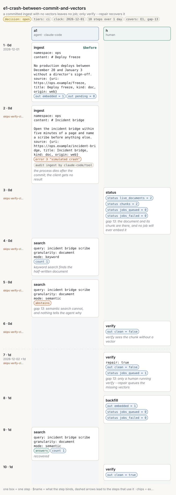

# e1-crash-between-commit-and-vectors

<!-- Generated by `memors-scenario book` from `internal/eval/testdata/scenarios/e1-crash-between-commit-and-vectors.yaml`. Do not edit: change the source and run `make scenario-docs`. -->

*a committed ingest with no vectors leaves no job; only verify --repair recovers it*

- **Decision:** open: the expectations pin today's behaviour of a documented gap, not the behaviour anyone has chosen ([Open and decided](../decisions.md))
- **Tiers:** ci
- **Covers:** [E1 Crash between commit and vectors](../catalogue.md#e1) · [gap 13](../gaps.md#gap-13)
- **Actors:** `a1` agent, client `claude-code` · `h` human
- **Length:** 10 steps over 1 day from 2026-12-01
- **Source:** [`internal/eval/testdata/scenarios/e1-crash-between-commit-and-vectors.yaml`](https://github.com/kKEo/memors/blob/master/internal/eval/testdata/scenarios/e1-crash-between-commit-and-vectors.yaml)

## Why it exists

E1 — Crash between commit and vectors. An ingest commits its transaction (source, document, chunks, audit row) and the process dies before the vectors are stored. The document is real: keyword search finds it, status counts it. But no job was queued, because jobs are made only when the embedder is absent or fails, not when the process never got that far (gap 13). Semantic search cannot see the document until someone runs `verify --repair`, which queues the missing vectors, and `backfill`, which embeds them. This file runs the crash in-process through the harness's `crash_at` fault; the binary tier will repeat it by killing `memors-mcp`. The steps marked gap 13 pin today's behaviour.

## Picture



[Open the picture on its own](e1-crash-between-commit-and-vectors.svg) to zoom. [Reading the picture](../pictures.md) explains lanes, chips and edges.

## Steps

| # | When | Actor | Op | What | Bind | Expects |
|---|---|---|---|---|---|---|
| 1 | Dec 1 (0d) | `a1` | `ingest` | \# Deploy freeze | `$before` | out |
| 2 | Dec 1 (0d) | `a1` | `ingest` | \# Incident bridge<br>*the process dies after the commit; the client gets no result* |  | error, audit |
| 3 | Dec 1 (0d) | `h` | `status` | *gap 13: the document and its chunk are there, and no job will ever embed it* |  | status |
| 4 | Dec 1 (0d) | `a1` | `search` | incident bridge scribe<br>*keyword search finds the half-written document* |  | count |
| 5 | Dec 1 (0d) | `a1` | `search` | incident bridge scribe<br>*gap 13: semantic search cannot, and nothing tells the agent why* |  | abstains |
| 6 | Dec 1 (0d) | `h` | `verify` | *verify sees the chunk without a vector* |  | out |
| 7 | Dec 2 (1d) | `h` | `verify` | *gap 13: only a human running verify --repair queues the missing vectors* |  | out, status |
| 8 | Dec 2 (1d) | `h` | `backfill` |  |  | out, status |
| 9 | Dec 2 (1d) | `a1` | `search` | incident bridge scribe<br>*recovered* |  | abstains, count |
| 10 | Dec 2 (1d) | `h` | `verify` |  |  | out |

## Invariants

All 15 [invariants](../invariants.md) run after every step, except:

- `verify-clean` after step 2
- `verify-clean` after step 3
- `verify-clean` after step 4
- `verify-clean` after step 5
- `verify-clean` after step 6
- `verify-clean` after step 7

## Source

<details>
<summary>e1-crash-between-commit-and-vectors.yaml (117 lines)</summary>

```yaml
# E1 — Crash between commit and vectors. An ingest commits its transaction
# (source, document, chunks, audit row) and the process dies before the
# vectors are stored. The document is real: keyword search finds it, status
# counts it. But no job was queued, because jobs are made only when the
# embedder is absent or fails, not when the process never got that far
# (gap 13). Semantic search cannot see the document until someone runs
# `verify --repair`, which queues the missing vectors, and `backfill`, which
# embeds them. This file runs the crash in-process through the harness's
# `crash_at` fault; the binary tier will repeat it by killing `memors-mcp`.
# The steps marked gap 13 pin today's behaviour.
name: e1-crash-between-commit-and-vectors
description: a committed ingest with no vectors leaves no job; only verify --repair recovers it
decision: open
tiers: [ci]
covers: [E1, gap-13]
clock: 2026-12-01
actors:
  a1: {kind: agent, client: claude-code}
  h:  {kind: human}
steps:
  - at: 0d
    actor: a1
    op: ingest
    args:
      namespace: ops
      content: |
        # Deploy freeze

        No production deploys between December 20 and January 3 without a director's sign-off.
      source: {uri: https://ops.example/freeze, title: Deploy freeze, kind: doc, origin: web}
    bind: before
    expect:
      out: {embedded: 1, pending: 0}

  - at: 0d
    actor: a1
    op: ingest
    note: the process dies after the commit; the client gets no result
    crash_at: before-vectors
    invariants: {skip: [verify-clean]}
    args:
      namespace: ops
      content: |
        # Incident bridge

        Open the incident bridge within five minutes of a page and name a scribe before anything else.
      source: {uri: https://ops.example/incident-bridge, title: Incident bridge, kind: doc, origin: web}
    expect:
      error: true
      error_contains: simulated crash
      audit: [{op: ingest, actor: claude-code, channel: tool}]

  - at: 0d
    actor: h
    op: status
    note: "gap 13: the document and its chunk are there, and no job will ever embed it"
    args: {}
    invariants: {skip: [verify-clean]}
    expect:
      status: {live_documents: 2, chunks: 2, jobs_queued: 0, jobs_failed: 0}

  - at: 0d
    actor: a1
    op: search
    note: keyword search finds the half-written document
    args: {query: incident bridge scribe, granularity: document, mode: keyword}
    invariants: {skip: [verify-clean]}
    expect: {count: 1}

  - at: 0d
    actor: a1
    op: search
    note: "gap 13: semantic search cannot, and nothing tells the agent why"
    args: {query: incident bridge scribe, granularity: document, mode: semantic}
    invariants: {skip: [verify-clean]}
    expect: {abstains: true}

  - at: 0d
    actor: h
    op: verify
    note: verify sees the chunk without a vector
    args: {}
    invariants: {skip: [verify-clean]}
    expect:
      out: {clean: false}

  - at: 1d
    actor: h
    op: verify
    note: "gap 13: only a human running verify --repair queues the missing vectors"
    args: {repair: true}
    invariants: {skip: [verify-clean]}
    expect:
      out: {clean: false}
      status: {jobs_queued: 1}

  - at: 1d
    actor: h
    op: backfill
    args: {}
    expect:
      out: {embedded: 1}
      status: {jobs_queued: 0, jobs_failed: 0}

  - at: 1d
    actor: a1
    op: search
    note: recovered
    args: {query: incident bridge scribe, granularity: document, mode: semantic}
    expect: {count: 1, abstains: false}

  - at: 1d
    actor: h
    op: verify
    args: {}
    expect:
      out: {clean: true}
```

</details>
